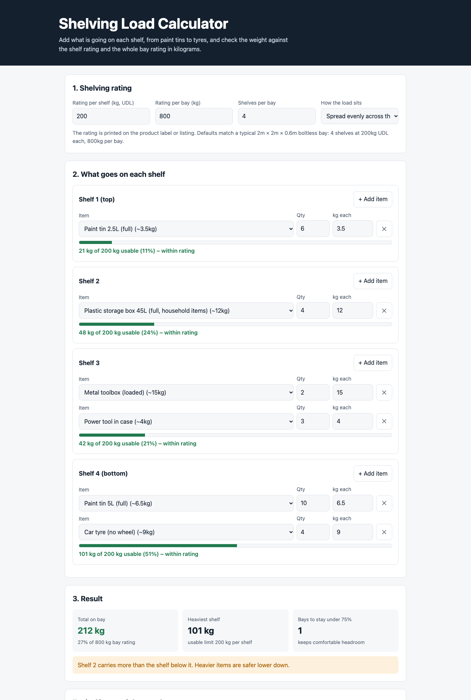

# Shelving Load Calculator – Check Shelf Weight Capacity in kg

A free, open-source **shelving load calculator** that checks whether a shelving unit can hold what is planned for it. Add paint tins, storage boxes, toolboxes, tyres or custom items to each shelf, and the calculator compares the weight against the **shelf weight capacity** (UDL) and the **bay weight capacity**.

**Live calculator:** https://rackingoutlet.github.io/shelving-load-calculator/ (also on [rackingoutlet.co.uk](https://rackingoutlet.co.uk/shelving-load-calculator/?utm_source=github&utm_medium=referral&utm_campaign=shelving_load_calculator&utm_content=readme))

## What it checks

- **Weight per shelf** against the shelf's UDL rating, with a green / amber / red status
- **Total weight per bay** against the bay rating (shelf and bay limits are separate)
- **Concentrated loads**: halves the usable rating when weight sits in one spot instead of spreading across the shelf
- **Load order**: warns when a higher shelf carries more than the shelf below it
- **Bays needed** to keep every bay under 75% of its rating

## Typical item weights included

| Item | Approx. weight |
|---|---|
| Paint tin 5L (full) | 6.5 kg |
| Plastic storage box 64L (full) | 18 kg |
| Archive box of paper files | 15 kg |
| Metal toolbox (loaded) | 15 kg |
| Car tyre on alloy wheel | 20 kg |
| Bag of cement 25kg | 25 kg |
| Water or fuel can 20L (full) | 21 kg |

The full list is in `index.html`. Estimates only; weigh unusual items.

## UDL in plain English

**UDL (uniformly distributed load)** is the weight a shelf holds when the load is spread evenly across its whole surface. A shelf rated at 200kg UDL is not designed to take 200kg resting on one point in the middle. For garage shelving, workshop shelving and warehouse boltless shelving, spreading the load and keeping the heaviest items on the bottom shelf are the two simplest ways to stay within the rating.

## Shelf weight capacity FAQ

### How much weight can a shelf hold?

It depends on the rating printed on the shelf's label or listing, and that rating normally assumes the weight is spread evenly (UDL). Boltless steel shelving is often rated somewhere between 100kg and 300kg per shelf. The RackingOutlet 2m Full Bay, for example, is rated at 200kg per shelf and 800kg for the whole bay. Wall-mounted shelves are different again: their limit depends as much on the brackets, fixings and wall as on the shelf itself.

### How do you calculate how much weight a shelf can hold?

Add up the weight of everything planned for the shelf, then compare the total with the shelf's UDL rating. If most of the weight sits in one spot rather than across the full shelf, plan to a lower figure; this calculator uses half the rating as a cautious rule of thumb. Then add the shelves together and check the total against the bay rating, which is a separate limit.

### What does UDL mean in racking and shelving?

UDL stands for uniformly distributed load: weight spread evenly across the whole shelf or beam. A 200kg UDL shelf is designed for 200kg laid across its full length and depth, not 200kg resting on one point in the middle.

### How do you convert a UDL rating to a point load?

There is no single conversion that applies to every shelf, because it depends on the shelf's design, span and supports. Only the manufacturer can give a true point-load figure. Without one, treating a concentrated load as roughly half the UDL rating is a cautious working assumption, and that is the figure this calculator uses.

## Default settings

The defaults match a common **2m × 2m × 0.6m boltless shelving bay**: 4 shelves at 200kg UDL each and 800kg per bay. All values can be changed to match any shelving unit's label.

## Run it locally

No build step and no dependencies. Download `index.html` and open it in a browser. Inputs are saved in the browser's local storage only; nothing is sent anywhere.

## Contributing

Corrections to item weights and new common items are welcome through issues or pull requests.

## About

Built and maintained by [RackingOutlet](https://rackingoutlet.co.uk/?utm_source=github&utm_medium=referral&utm_campaign=shelving_load_calculator&utm_content=readme), a Manchester supplier of [800kg heavy duty boltless shelving](https://rackingoutlet.co.uk/product/heavy-duty-metal-shelving-800kg-capacity/?utm_source=github&utm_medium=referral&utm_campaign=shelving_load_calculator&utm_content=readme) and a free [boltless shelving assembly guide](https://rackingoutlet.co.uk/how-to-assemble-boltless-shelving/?utm_source=github&utm_medium=referral&utm_campaign=shelving_load_calculator&utm_content=readme).

Results are guidance only. Always follow the shelving manufacturer's rating and instructions.

## Licence

MIT
